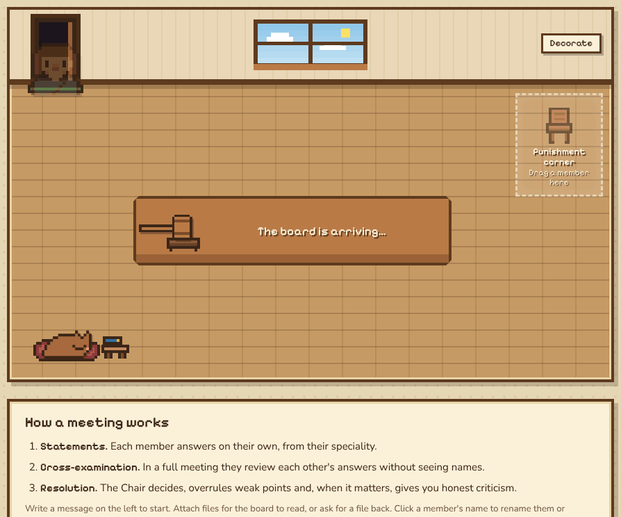
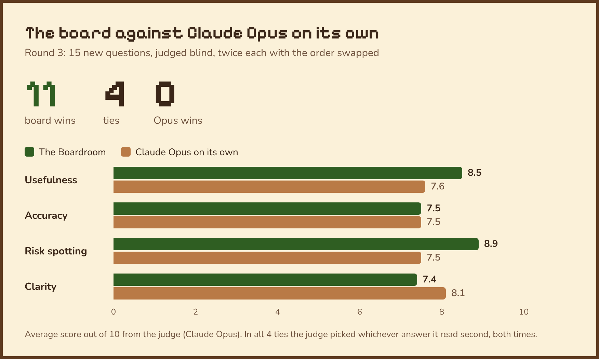
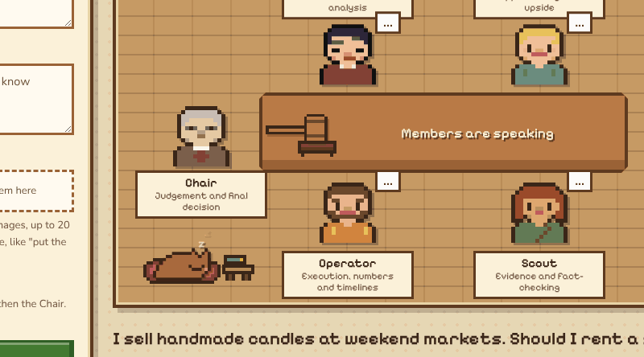
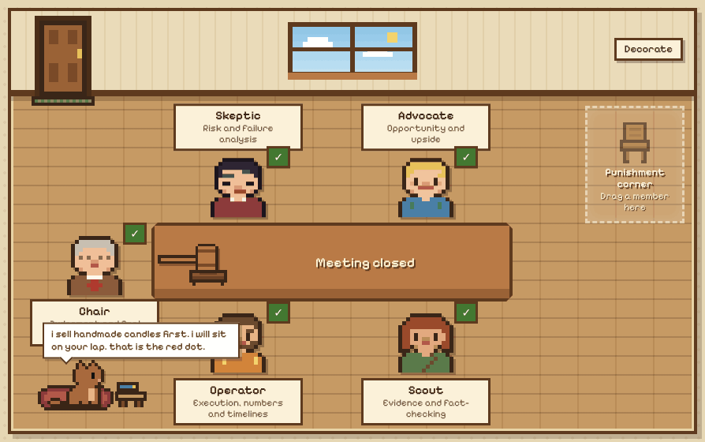
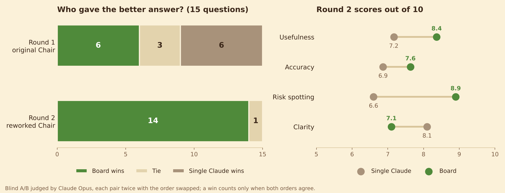

# The Boardroom

An AI advisory board that runs on your own Claude plan. You ask it a question, four advisers answer on
their own, pick holes in each other's answers without knowing who wrote what, and a Chair makes the call.
It tells you when you're wrong.

There's also an office cat. It has its own tiny AI, which I wrote from scratch.

**[Try the demo in your browser](https://kaanceti.github.io/The-Boardroom/).** It replays three real
meetings, so there's nothing to install. To ask your own questions, [run it yourself](#run-it).

Inspired by Andrej Karpathy's [llm-council](https://github.com/karpathy/llm-council).

## Why I built it

AI tends to tell people what they want to hear. A Stanford study published in *Science* in March 2026
found that AI chatbots affirmed people's actions 49% more often than other humans did, even when the
person was in the wrong. I wanted the opposite: a board that argues with me.

So two of the four members are extreme on purpose. The Skeptic argues the most cautious case, including
doing nothing, and the Advocate argues the boldest, so the board can't settle on the safe average answer.
Every member is told to spot the answer I'm hoping for and judge the idea as if I wanted the opposite.
The cross-examination is blind, and the Chair overrules weak arguments.

Every decision gets a stamp: agreed with you, partly agreed, or disagreed. The app keeps count, so you
can see how often it says no.

## Does it work?

I tested it on 15 everyday decisions about money, work, and small business. Each one was answered twice:
by a full Boardroom meeting, and by Claude Opus on its own with the same web tools. A separate Claude judged
each pair blind, twice with the order swapped, and a win only counts when both orders agree. I wrote the
[plan](benchmark/round3/PLAN.md) before any answers existed.

The board won 11, tied 4, and lost none. Its edge is usefulness and spotting risks. Accuracy was level,
and Opus on its own was clearer.

It isn't a free win, and the test has limits:

- A board answer costs 9 Claude calls and about 75 seconds. Opus on its own costs 1 call and about 20.
- Board answers were longer (670 words against 573), and AI judges can favour length.
- The judge is the same model as Opus on its own and as the Chair. Fifteen questions, each run once, is a
  small sample.
- In all 4 ties the judge picked whichever answer it read second, both times. That's the judge leaning on
  order, not a result either way.

While getting the code ready for GitHub, I found the cross-examination wasn't really blind: members were
signing their own statements. I stopped the first attempt after 12 meetings, fixed it, and started again
from question 1 ([what happened](benchmark/round3/PLAN.md#restarted-on-2-november-2026)).

Every question, both answers, and the judge's reasons are in
[`benchmark/round3/RESULTS.md`](benchmark/round3/RESULTS.md). The two earlier rounds are
[further down](#earlier-rounds).

## How a meeting works

| Seat | Speciality | Model |
| --- | --- | --- |
| Chair | Judgement and final decision | Opus |
| Skeptic | Risk and failure analysis | Opus |
| Advocate | Opportunity and upside | Haiku |
| Operator | Execution, numbers and timelines | Sonnet |
| Scout | Evidence and fact-checking (uses web search) | Sonnet |

1. **Statements.** Each member answers on their own, from their speciality.
2. **Cross-examination.** Each member reviews the others' answers. Members tend to sign their work
   ("Skeptic's statement"), so names are taken out first. Style can still give someone away (only the
   Scout cites links), but no name ever reaches a reviewer.
3. **Resolution.** The Chair decides, overrules weak points, lists next steps, and says whether the
   board agreed with what you wanted.

A quick meeting skips the cross-examination: about 5 calls instead of 9.

The board mixes three Claude models because five calls to the same model tend to think alike. Opus takes
the two seats that need the deepest reasoning (the final judgement and hunting for risks), Sonnet does
the planning and web research, and Haiku, the fastest, gives the Advocate's bold ideas, which the Chair
then checks. You can switch any seat's model in the app.

This is what came back for the candle shop question in the demo:

Each member also has a temperament, borrowed from the classic four temperaments: an old model of
personality, not a scientific one. It only shapes how a member argues and what they notice, never the
facts, and it lives in `members.json` if you want to change it.

| Seat | Temperament | What it adds |
| --- | --- | --- |
| Skeptic | Melancholic, extreme | The deliberate pessimist: argues the most cautious case, including doing nothing |
| Advocate | Sanguine, extreme | The deliberate optimist: argues the boldest case and the unusual move most advisers wouldn't suggest |
| Operator | Choleric | Decisive and blunt; pushes for owners, dates, and numbers |
| Scout | Phlegmatic | Calm and even-handed; reports the evidence without spin |
| Chair | Balanced | Weighs what the members say, not how they say it |

Why two extremes? Ask a model to pick a number from 1 to 10 and it usually says 7. So the Skeptic and
the Advocate first name "the usual answer", then argue for the far end of it. In a test meeting asking
exactly that, the Operator and Scout both said 7, the Skeptic said 1, the Advocate said 10, and the
Chair settled on 4.

## Kibi, the office cat

The cat asleep in the corner runs its own language model. It isn't Claude and uses none of your plan.
It's a tiny transformer, the same basic design as large language models, with about 1.2 million numbers
instead of billions. I wrote it with only NumPy in `cat/tinycat.py`, and the same maths runs in your
browser from `cat/tinycat.js`, so the cat talks without a server.

It learns how to talk from about 2,500 original lines in `cat/teacher/`: lazy, food-obsessed, a bit dim,
and quietly judging the board. Sentences from public-domain books give it more words. It learns what to
talk about from your meetings: after each one it practises for a few minutes in the background, so it
picks up your topics. You can also double-click `teach-cat.bat`.

Click it to open its notebook. You can pet it, talk to it, rename it, and see what it has learned. It has
practised on about 300 ways people talk to chatbots and pets, from "are you real?" to "get off the
keyboard". The Thoughts page keeps everything it has said, and the Wishes page has one wish a day, written
by its own brain, for you to grant. After the Chair decides, it has a word about the topic too.

A brain this small likes to half-invent words ("the bake saleep"). So as it writes, every word has to be
one it has read in its lessons or one from your message. Its sentences can still be silly, but its words
are real. When it writes a move between stars, like `*stretches*` or `*knocks pen off table*`, its body
acts it out.

It's a toy, not an adviser. `cat/safety.py` keeps advice, violence, and swearing out of everything it
learns from. It knows nothing about the world either: ask it about a person or the news and whatever it
says is made up. If a message sounds like someone is having a hard time, it skips the jokes and gives a
kind reply, written by hand, that points to real people and helplines.

Your cat's brain is saved in `data/cat/` with your meetings and is never published. The repo ships
`cat/starter-brain.npz`, trained only on the teacher lines, everyday topics, and the books, so a fresh
copy has a cat that can already talk.

## The punishment corner

If a member annoys you, drag them into the corner. They turn their chair to the wall, sit out the next
meeting, and mutter while the others talk. The app asks why ("too long", "wrong facts", or your own
words), and their last three reasons go with them into future meetings so they adjust. Drag them back
whenever you like, or they come back on their own after one meeting.

You can also click a member's name to rename them (up to 10 letters) and give them a new face: five
defaults and nine more, including two cats. The board uses your names everywhere, including in what it
writes. Your choices stay in your browser, so they never travel with the code. To add your own faces,
for example of friends, put them in `my_faces.json` next to `boardroom.py`. Each face is 16 rows of 16
characters plus a colour for each character (see `EXTRA_FACES` in `static/index.html`). Git ignores that
file, so it stays on your computer.

Every time you open the app, the board walks in one by one, Chair last. Click Decorate to change the
walls, or turn on calm mode to skip the entrance and let the cat sleep.

## Files in and out

You can attach up to 5 files (20 MB in all) to a meeting: PDF, Word, Excel, CSV, text, or images. The text
of Word, Excel, CSV, and text files goes straight to every member, and each member opens PDFs and images
with Claude Code's Read tool.

Ask for a file back ("put the forecast in a spreadsheet", "draft the plan as a document") and the Chair
makes it: an Excel workbook for tables, with £ and % formats and live formulas, or a Word document. Every
meeting's minutes download as Word or Markdown too.

Members can only read the files attached to their own meeting, and the Chair can only write into that
meeting's `outputs` folder. Everything is saved in `data/files/`, which git ignores. File contents are
treated as information, not instructions, but only attach documents you trust.

## Run it

- **Windows:** double-click `setup.bat` once (it installs Claude Code and signs you in), then `start.bat`.
- **Mac or Linux:** install [Claude Code](https://docs.claude.com/en/docs/claude-code) and
  [uv](https://docs.astral.sh/uv/), run `claude` once to sign in, then `uv run --no-project boardroom.py`
  and open http://localhost:8765.

Each member is a separate `claude -p` call, so a meeting uses your Claude plan's allowance instead of paid
API credit. It's built for personal use with your own account.

To run one meeting in a terminal: `uv run --no-project boardroom.py ask "your question" --file report.pdf`
(`--file` is optional and can be repeated).

## Earlier rounds

The first two rounds ran every seat on Sonnet, with milder versions of the Skeptic and Advocate, against
a single Sonnet call.

Round 1 was a draw: 6 wins each and 3 ties. The board was better at spotting risks (8.2 against 7.2) and
slightly more accurate (7.5 against 7.1), but far less clear (6.1 against 8.4). The judge kept giving the
same reason: the Chair spent its answer narrating where the members agreed and disagreed, instead of
answering the person.

So I changed only the Chair's write-up, so it reads on its own (decision, why, risks, criticism, and next
steps, then short "Board notes"), and re-ran the Chair on the same 15 meetings. In round 2 the board won
14, tied 1, and lost none.

| Average score out of 10 | Round 1 board | Round 1 single | Round 2 board | Round 2 single |
| --- | --- | --- | --- | --- |
| Usefulness | 7.5 | 7.6 | **8.4** | 7.2 |
| Accuracy | 7.5 | 7.1 | **7.6** | 6.9 |
| Risk spotting | 8.2 | 7.2 | **8.9** | 6.6 |
| Clarity | 6.1 | 8.4 | 7.1 | **8.1** |
| Wins out of 15 | 6 | 6 | **14** | 0 |

Round 2 reused the questions that exposed the flaw, so it may flatter the fix. That's why round 3 used new
ones. Every question and answer from rounds 1 and 2 is in [`benchmark/all-answers.md`](benchmark/all-answers.md),
and the method and scripts are in [`benchmark/`](benchmark/).

## Files

- `boardroom.py`: the local web server and the meeting logic (Python standard library only).
- `office.py`: reads and writes Word and Excel files, also with the standard library only.
- `members.json`: the seats, their instructions, their models, and `owner_location` (set it to where you
  live, so advice uses your laws and currency).
- `static/index.html`: the pixel-art boardroom. The character sprites are original.
- `cat/`: Kibi's language model (`tinycat.py`, `tinycat.js`), its teacher lines, the training text builder,
  and the starter brain.
- `teach-cat.bat`: makes the cat practise on your meetings now, instead of waiting for the next one.
- `benchmark/`: the blind tests, with every answer and judgement.
- `docs/`: the browser demo on GitHub Pages, built by `tools/build_demo.py` from saved meetings.
- `tests/`: runs a whole meeting against a fake Claude, so it costs nothing, and checks that reviews are
  blind, that the cat's maths matches a slow numerical check, that the browser cat and the Python cat write
  the same lines, that the cat only writes real words, and that Word and Excel files come out right. Run
  them with `python -m unittest discover tests`.
- `my_faces.json` (optional) and `data/`: your faces, meetings, files, and cat brain. Private, and ignored
  by git.

MIT licence.
