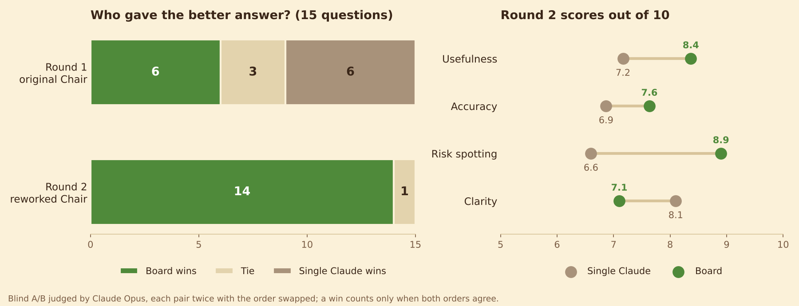

# Blind test: board vs single Claude

Results are summarised in the main [README](../README.md#does-a-board-beat-one-claude).

## Method

1. `run.py` answers each question twice with the same model (Sonnet) and the same web tools:
   one direct Claude call, and one full Boardroom meeting (4 statements, 4 cross-examinations, the Chair).
2. `judge.py` asks Claude Opus to compare each pair. It scores usefulness, accuracy, risk spotting and
   clarity from 1 to 10 and picks a winner. Every pair is judged twice with A and B swapped; a win only
   counts when both orders agree, otherwise it is a tie. Member names and "the board" are replaced with
   neutral labels before judging. The board's answer still has its own headings, so the test is blind
   to labels, not to format.
3. `rechair.py` (round 2) re-runs only the Chair on the saved round-1 meetings with the reworked
   resolution format, then `judge.py opus answers_v2.json` judges again against the same single answers.

## Results

| | Board wins | Ties | Single wins | Board avg | Single avg |
| --- | --- | --- | --- | --- | --- |
| Round 1 (original Chair) | 6 | 3 | 6 | 7.3 | 7.6 |
| Round 2 (reworked Chair) | 14 | 1 | 0 | 8.0 | 7.2 |

## Files

- [`all-answers.md`](all-answers.md): every question with both answers, the scores and the judge's reasons.
- [`meetings/`](meetings/): the full board meetings (statements and cross-examination), as Markdown minutes and JSON.
- `questions.json`: the 15 questions.
- `answers.json`: round 1 answers (single and board). `answers_v2.json`: round 2 board answers.
- `judgments.json`, `judgments_answers_v2.json`: every judgement, both orders.
- `run.py`, `judge.py`, `rechair.py`: the test itself. `write_report.py` rebuilds `all-answers.md`.

To re-run it, put a copy of the app in `app/` next to the scripts. It uses your own Claude plan:
about 150 calls for round 1 and 45 for round 2.
